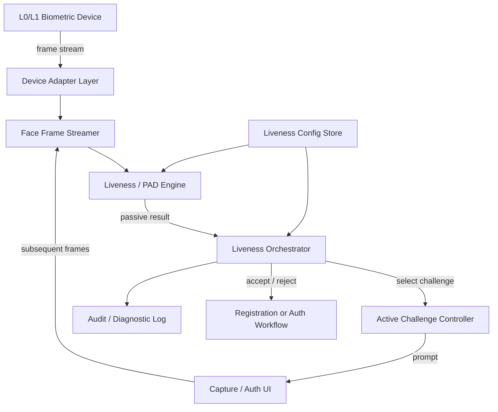
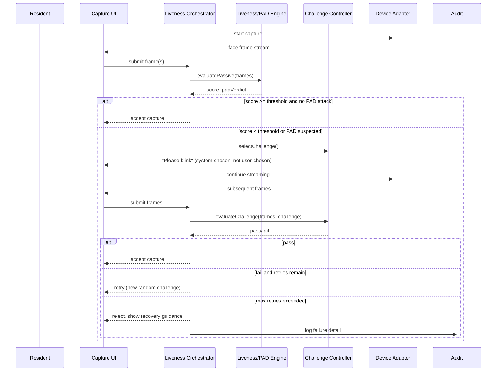

# Face Liveness & PAD Module — Architecture

## 1. Component overview

- **Device Adapter Layer** — isolates vendor SDKs behind one interface (`FaceFrameSource`), so the engine never talks to a specific vendor's SDK directly. This is what "remain independent of any specific biometric vendor" in the spec requires.
- **Liveness / PAD Engine** — stateless scorer. Given a frame (or short window of frames), returns a passive liveness score + PAD verdict. Runs fully on-device (no network call).
- **Liveness Orchestrator** — the state machine described in the spec (passive → threshold check → active challenge → accept/retry/reject). This is the piece that's identical across resident registration, operator auth, and supervisor auth — those three just call the same orchestrator with a different "policy" from config.
- **Active Challenge Controller** — randomly selects a challenge type, tracks landmark state across the frame window, decides pass/fail.
- **Config Store** — per the spec: enable/disable, thresholds, challenge types, timeout, max retries, per-workflow policy.
- **Audit Log** — PAD failure detail goes here only; the UI only ever sees a generic message.

## 2. Sequence diagram — resident registration path

Operator and supervisor authentication reuse this exact same diagram — only the trigger point and the config policy differ (see `LivenessConfig.workflow`).

## 3. Passive → Active decision logic

1. Passive engine returns `score ∈ [0,1]` and `padDetected: boolean` (+ optional `attackType` for audit only).
2. If `score >= config.passiveThreshold && !padDetected` → **accept immediately**, no user friction.
3. Else → **enter active mode**: pick one challenge at random from `config.enabledChallengeTypes`, never letting the resident/operator choose it.
4. Active mode re-runs the passive/PAD check on every incoming frame *in addition to* validating the requested action — a live person performing the wrong action, or a static image being puppeted, should still fail.
5. On success → accept. On failure → retry up to `config.maxRetries`, then hard-fail with generic UI message + detailed audit log entry.

## 4. Offline-first constraint

Everything above must run with zero network calls. The only thing allowed to touch the network is a background **model sync** job (new PAD model weights, new challenge types) that swaps in a validated model file when connectivity is available — never blocking or altering the live decision path.

## 5. ISO/IEC 30107 alignment notes

- Passive engine output should be tunable via a single **APCER/BPCER trade-off threshold**, not a hardcoded cutoff — this maps directly to `config.passiveThreshold`.
- PAD attack categories to explicitly test against: print attack, screen replay, video replay (per spec) — the bonus "mock device + automated PAD attack scenarios" task is really an ISO/IEC 30107-3 style test harness in miniature.
- Keep APCER/BPCER numbers from your test set in the technical design doc — judges will be looking for this, not just a demo video.
